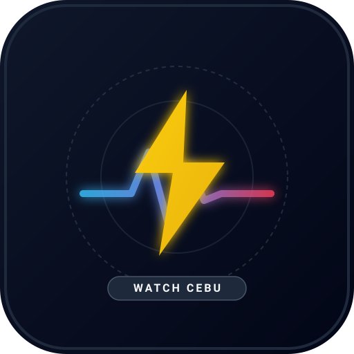

<p align="center">
  
</p>

<h1 align="center">WATCH CEBU</h1>

<p align="center">
  <strong>Civic Situational Awareness & Multi-Hazard Platform for Metro Cebu and the Visayas</strong>
</p>

<p align="center">
  <a href="https://www.typescriptlang.org/"></a>
  <a href="https://leafletjs.com/"></a>
  <a href="https://vitejs.dev/"></a>
  <a href="https://vitest.dev/"></a>
  <a href="public/manifest.webmanifest"></a>
  <a href="#-1-veco-scheduled-power-outage-tracking--franchise-territory"></a>
  <a href="https://www.w3.org/WAI/WCAG22/quickref/"></a>
  <a href="LICENSE"></a>
</p>

---

## 📌 Overview

**Watch Cebu** is an open-source, zero-cost, high-reliability civic monitoring dashboard built specifically for residents, emergency responders, and businesses in Metro Cebu and surrounding Visayan provinces. 

Unlike traditional platforms riddled with ads, analytics trackers, and heavy dependencies, Watch Cebu is engineered as an **offline-first, dark control-room interface** that synthesizes municipal power outages, seismic events, severe tropical weather, atmospheric air quality, and hourly weather forecasts into a unified, high-speed map experience.

```
       ┌─────────────────────────────────────────────────────────────┐
       │                   WATCH CEBU CONTROL ROOM                   │
       │       [ Cebu Island Silhouette • Civic Radar Watch ]        │
       ├─────────────────┬──────────────────────┬────────────────────┤
       │ ⚡ POWER FEED    │ 🌋 SEISMIC ACTIVITY  │ 🍃 AIR & HAZE      │
       │ VECO Franchise  │ PHIVOLCS DOST        │ Open-Meteo AQI     │
       │ 674 km² (8 LGUs)│ 300km Watch Radius   │ Transboundary Haze │
       ├─────────────────┼──────────────────────┴────────────────────┤
       │ 🌀 SEVERE WEATHER│ 🌦️ TODAY'S FORECAST                       │
       │ DOST-PAGASA     │ 24h Hourly Horizon • Rain % • Wind Spd    │
       │ TCWS #1-5 Track │ Open-Meteo High-Resolution Ensemble       │
       ├─────────────────┴───────────────────────────────────────────┤
       │ 📱 PWA & OFFLINE RESILIENCE: 3-Tier SW • 200-Tile LRU Cache │
       │ 🗺️ LEAFLET 1.9.4 CORE: CartoDB Dark Matter • Strict Bounds  │
       └─────────────────────────────────────────────────────────────┘
```

---

## 🌟 Key Features

### ⚡ 1. VECO Scheduled Power Outage Tracking & Franchise Territory
- **Complete Franchise Territory Coverage (674 km²)**: Comprehensive tracking across all **4 cities** (*Cebu City, Mandaue City, Talisay City, City of Naga*) and **4 municipalities** (*Liloan, Consolacion, Minglanilla, San Fernando*) served by Visayan Electric.
- **Enriched 367-Feature Boundary Dataset**: Fully resolves all 80 Cebu City barangays, including rural mountain barangays (*Lusaran, Tagbao, Sudlon, Babag, Sirao, Paril*) and specialized economic/industrial zones (*Cebu IT Park, CITP, MEZ*), reaching **100% geocoding resolution** for live advisories.
- **Granular Street & Landmark Parsing**: Employs heuristic NLP (`extractStreets`) to parse scheduled maintenance bulletins from Visayan Electric Company (VECO). Retains abbreviations and initialisms (e.g. *A. Cortes Ave.*, *P. Cabantan St.*) without truncating on periods.
- **Provenance-Aware Geocoding**: Visual pins distinguish between street-level verified coordinates and municipal/barangay centroid fallbacks.
- **Day Tabs Filter Bar**: Horizontal interactive tabs filter interruptions by day across the current week.
- **Deterministic Hashing**: Advisories are indexed with SHA-256 hashes to prevent duplicates across runs.

### 🌋 2. PHIVOLCS Seismic Hazard Monitoring
- **300 km Watch Radius**: Automatically monitors and filters earthquake bulletins from DOST-PHIVOLCS within 300 km of Cebu City (`10.3157°N, 123.8854°E`), capturing seismic activity across Cebu, Bohol, Leyte, Negros, Samar, and Panay.
- **Option C Compound Marker Design**: Raw SVG pin featuring an annular location-name wedge, magnitude core, and GPU-accelerated pulse for significant (<24h or M4.0+) quakes.
- **Zero Third-Party Map Bloat**: Renders cleanly via native Leaflet `L.divIcon` without heavyweight animation libraries.

### 🌀 3. DOST-PAGASA Multi-Hazard Severe Weather & Storm Track
- **Tropical Cyclone Wind Signals (TCWS #1 to #5)**: Parses active severe weather bulletins directly from DOST-PAGASA, identifying storm classification (*Tropical Depression, Tropical Storm, Severe Tropical Storm, Typhoon, Super Typhoon*), storm name, international codename, central pressure (hPa), and maximum sustained winds (km/h).
- **Heavy Rainfall Warning System**: Automatically alerts users to active color-coded rainfall advisories (Yellow, Orange, Red) indicating expected downpour rates (mm/hr) and localized flood/landslide hazards.
- **Interactive Leaflet Storm Track Layer**: Visualizes historical storm fixes, current eye position, animated forecast track line, and 72-hour cone of uncertainty directly on the dark basemap.
- **Edge Serverless Endpoint (`/api/pagasa`)**: Serves severe weather bulletins with a 10-minute CDN cache (`s-maxage=600, stale-while-revalidate=1800`) and automatic fallback to verified backup fixtures if upstream government portals hang.

### 🍃 4. Atmospheric Air Quality & Transboundary Haze Advisory
- **Live Open-Meteo AQI Feed**: Tracks US AQI, PM2.5, PM10, Carbon Monoxide (CO), and Aerosol Optical Depth (AOD) for Metro Cebu.
- **High-Contrast Text Tokens (7:1+ AAA Ratio)**: Specially tuned color-contrast tokens (including `#0F172A` dark slate text on Moderate Yellow `#EAB308`) for maximum daylight and nighttime legibility in bright tropical sunlight.
- **Continuous Spectrum Gauge**: 6-color segmented gradient track with dynamic needle positioning.
- **Transboundary Smoke Haze Architecture**: Structured recurring-hazard advisory detailing the seasonal *habagat* (southwest monsoon) wind vector transporting wildfire particulates from Indonesia (Kalimantan/Sumatra) to Cebu.

### 🌦️ 5. Today's Weather Forecast (Phase 6 Dropdown Drawer)
- **Top Slide-down Drawer**: A single click on the header's `🌦️ Forecast` button smoothly slides down a horizontal-scrolling 24-hour horizon drawer.
- **Compact Scannable Hour Cards**:
  - Hour timestamp with a glowing `NOW` pill for the current hour.
  - Standard WMO Weather Interpretation Code icons (Clear, Cloudy, Rain, Thunderstorm).
  - Expected Rain Probability percentage (`🌧️ %`).
  - Wind speed in km/h (`💨 km/h`).
- **Eliminates Flawed Tile Layers**: Replaced transparent Doppler radar tiles and low-resolution satellite overlays with structured, lightweight forecast metrics that load instantly.

### 📱 6. PWA & Offline Resilience (3-Tier Service Worker Architecture)
- **Installable Standalone Application**: Fully compliant with W3C Web App Manifest (`manifest.webmanifest`) specifications, allowing one-tap installation on Android, iOS, Windows, and macOS home screens with custom SVG/PNG app icons (`icon-192.png`, `icon-512.png`).
- **Tier 1 (Static App Shell Cache)**: Pre-caches core HTML, JS, CSS, and SVG iconography (`watch-cebu-static-v1`). Serves the control room shell instantly with background revalidation.
- **Tier 2 (Dynamic API Cache)**: Network-first caching strategy for `/api/power`, `/api/earthquakes`, `/api/pagasa`, and Open-Meteo endpoints (`watch-cebu-api-v1`). If offline or upstream is down, serves the freshest local snapshot seamlessly.
- **Tier 3 (Bounded LRU Basemap Cache)**: Leaflet tile caching (`cartodb-tiles-v1`) with a strict **200-tile LRU ceiling**. Prevents runaway mobile cache expansion and respects free-tier storage boundaries while allowing smooth offline exploration.
- **Offline Amber Banner & Emergency Hotlines**: Immediately detects network disconnection (`navigator.onLine` and `window.addEventListener('offline')`), presenting an amber status indicator and direct tap-to-call civic emergency links (`tel:`) for Cebu City DRRMO, VECO Emergency, Red Cross, BFP, and ERUF.

### 🛡️ 7. Control Room UX, Mobile-First Ergonomics & Accessibility
- **Elevated Mobile Z-Index Hierarchy**: Strict layering architecture (`z-index: 1500` for mobile bottom sheets and status popovers; `z-index: 1450` for backdrops) preventing background blur overlays from rendering over cards or action buttons.
- **Decoupled Data Architecture**: All feeds fetch in parallel (`Promise.allSettled`). If one endpoint is offline, other layers continue functioning uninterrupted.
- **Transparent Freshness Indicators**: Header freshness chips display `Live · Verified`, `Fetching...`, or `⚠️ Backup Fixture Data` with fallback warnings.
- **Full Keyboard & Screen Reader Accessibility**: Meets **WCAG 2.2 AA** criteria with high-contrast `:focus-visible` 2px cyan outlines across all interactive elements, complete `Tab` and `Shift+Tab` focus traps inside modal drawers, backdrop scrim click dismissal, and `Escape` key support.
- **Strict Viewport Containment**: Leaflet viewport clamped (`minZoom: 7`, bounds `[7.4, 120.9]` to `[13.2, 126.9]`, `viscosity: 1.0`) preventing unnecessary world panning.

### 🔍 8. Hybrid 3-Tier Search & Auto-Zoom (Cities, Barangays, Streets)
- **Instant Camera Navigation**: Searching any barangay, municipality, street, or landmark and submitting (`Enter` or search button) automatically flies the map camera and zooms directly to that area.
- **Tier 1 (Instant Active Pins)**: Matches in-memory power outage advisories and seismic events (0ms latency, offline). If a single pin matches, auto-pans, zooms to Level 16, and opens its details; if multiple pins match, fits the map bounds around all pins.
- **Tier 2 (Offline Barangay & LGU Centroids)**: Built-in offline dictionary of 444 Metro Cebu LGUs, barangays, and landmarks extracted from `metro-cebu-barangays.geojson`. Cleans prefixes (*"Brgy."*, *"Barangay"*, *"City of"*) and zooms instantly without network calls.
- **Tier 3 (Cebu-Bounded Public Geocoding)**: OpenStreetMap Nominatim fallback strictly geo-fenced to Cebu Province (`[9.3°N, 123.1°E]` to `[11.4°N, 124.4°E]`) for specific streets (*e.g. Gorordo Ave, Colon St*). Only executes on explicit form submission to strictly adhere to free-tier fair-use limits.

### 🏝️ 9. Custom Geographic Visual Identity (Civic Radar Watch)
- **Authentic Island Silhouette**: Replaced generic utility lightning bolt iconography with a resolution-independent vector silhouette of Cebu Island and surrounding islets (*Bantayan, Mactan, Olango, and Malapascua*).
- **Control-Room Color Palette**: Styled in Electric Cyan (`#38BDF8`) on deep Slate 900 (`#0F172A`) with dual concentric geospatial radar range rings and a dual-core red pulse pin (`#EF4444`) centered directly on Metro Cebu (`10.3157°N, 123.8854°E`).
- **Unified Brand Surface**: Consistently integrated into the desktop and mobile header brand mark, browser SVG/PNG favicon, and PWA manifest app icons (`icon-192.png`, `icon-512.png`), ensuring social shares on Facebook and LinkedIn present a distinct, professional visual identity.

### 📋 10. "Pin My Barangay" & Zero-Tile List View (Resident Usability & Low-Bandwidth Mode)
- **"⭐ Pin My Barangay"**: Direct 1-tap local area bookmarking stored safely in the resident's browser (`localStorage`). Computes upcoming scheduled interruptions for their specific neighborhood without accounts, logins, or server tracking.
- **Zero-Tile List View Alternative (`[ 🗺️ Map | 📋 List ]`)**: Fast, text-first scannable view grouped by date. Allows users on metered LTE data or weak mobile connections to inspect outages without downloading hundreds of map tiles.
- **🚨 Urgent Severe Weather & TCWS Alert Banner**: Prominently surfaces active DOST-PAGASA Tropical Cyclone Wind Signals (TCWS #1–#5) and Heavy Rainfall Warnings (Yellow, Orange, Red) directly on the main control-room view with 1-tap storm track navigation.
- **Honest Freshness & Delay Warnings**: Freshness badge dynamically switches to amber `⚠️ Data Delayed` when weather or environmental feeds exceed 24 hours, preventing stale data from masquerading as current.
- **Guard Against False "No Outages"**: The green "No outages today" confirmation is strictly suppressed when using fallback fixture data or when the power feed is degraded.
- **Distant Micro-Quake Filtering**: Filters seismic events under M3.0 farther than 100 km away by default to minimize visual clutter on mobile screens, with an opt-in toggle in the map legend.

---

## 🛠️ Tech Stack & Architecture

| Layer | Technologies |
| :--- | :--- |
| **Frontend Runtime** | TypeScript 5.8, Vite 7, HTML5, Vanilla CSS3 (Dark Control-Room Design System) |
| **Mapping Engine** | Leaflet 1.9.4, CartoDB Dark Matter Basemap Tiles, SVG Compound Pin Renderers |
| **Spatial Boundaries** | 367-Feature GeoJSON (`metro-cebu-barangays.geojson`), 674 km² VECO Franchise (8 LGUs, 80 Cebu City Barangays) |
| **PWA & Offline Engine**| W3C Web App Manifest, 3-Tier Service Worker (`sw.js`), 200-Tile Bounded LRU Cache, Tap-to-Call Emergency Hotlines |
| **Data Ingestion** | Cheerio 1.0, Node.js HTTP/HTTPS, Axios, Native Fetch, RegEx NLP Street Extraction |
| **Testing & Quality** | Vitest (324 tests, 29 suites: unit, component, fuzzing, concurrency, UI load), Chrome DevTools Protocol (CDP) |
| **External APIs** | DOST-PAGASA (Severe Weather & Storm Track), Open-Meteo (AQI & Forecast), VECO Portal, DOST-PHIVOLCS |
| **State & Cloud Edge** | Decoupled In-Memory State, `localStorage` Optimistic Cache, Vercel Edge Serverless Functions |

---

## 📁 Project Structure

```text
Watch-Cebu/
├── api/                          # Vercel Edge Serverless function handlers
│   ├── earthquakes.ts            # PHIVOLCS seismic feed handler (edge CDN cached)
│   ├── pagasa.ts                 # DOST-PAGASA severe weather & storm track endpoint
│   └── power.ts                  # VECO scheduled power interruptions endpoint
├── data/                         # GeoJSON polygons, barangay centroids, live snapshots
│   ├── metro-cebu-barangays.geojson # 367-feature franchise boundary & mountain barangay dataset
│   ├── live_power_outages.json   # Active VECO power maintenance snapshot
│   ├── live_earthquakes.json     # Active PHIVOLCS seismic activity snapshot
│   ├── live_pagasa_bulletin.json # Active DOST-PAGASA tropical cyclone bulletin
│   └── fixtures/                 # Real historical VECO, PHIVOLCS & PAGASA fixtures
├── docs/                         # Technical documentation & architecture decisions
│   ├── adr/                      # Architecture Decision Records (ADR-001 to ADR-005)
│   ├── internal/                 # Internal roadmaps, agent logs & planning docs
│   ├── schemas/                  # JSON schema definitions (PagasaBulletin, etc.)
│   └── Data-Standards.md         # Field definitions, schema contracts, confidence tiers
├── public/                       # Static web assets & PWA files
│   ├── icons/                    # Progressive Web App icons (icon-192, icon-512, SVG)
│   ├── manifest.webmanifest      # W3C Web App Manifest (PWA standalone configuration)
│   └── sw.js                     # 3-tier Service Worker (static shell, dynamic API, 200-tile LRU)
├── scripts/                      # Automated ingestion, verification & utility scripts
│   ├── generate_pwa_icons.ts     # PWA PNG icon rasterizer
│   ├── run_scheduled_fetch.ts    # Headless scraping & atomic snapshot generator
│   ├── verify_phase6_forecast.ts # Headless Chrome CDP verification for Forecast drawer
│   ├── verify_responsive_overhaul.ts # Multi-device CDP responsive test runner
│   └── verify_stage6b_containment.ts # Viewport bounds & zoom clamping validation
├── server/                       # Node.js backend proxy & dev scraping middleware
│   └── api.ts                    # Live feed scraping orchestrator with AbortSignal timeouts
├── src/                          # Application source code
│   ├── parsers/                  # Cheerio scrapers & heuristic regex engines
│   │   ├── pagasa.ts             # DOST-PAGASA TCWS signals & storm track parser
│   │   ├── phivolcs.ts           # Seismic bulletin scraper with Haversine filter
│   │   ├── veco.ts               # Power interruption table & street parser
│   │   └── vecoRates.ts          # Electric tariff rate change detector
│   ├── resolvers/                # Geocoding & coordinate provenance resolvers
│   ├── types/                    # Shared TypeScript domain models & schemas
│   │   ├── index.ts              # Core feed, advisory & seismic types
│   │   └── pagasa.ts             # PAGASA severe weather & storm track interfaces
│   ├── ui/                       # Control-room frontend components & map controller
│   │   ├── components/           # Header, ForecastDrawer, AirQualityDrawer, OfflineBanner, About, ListView, UrgentAlertBanner
│   │   ├── map/                  # Leaflet MapController & Option C SVG pins / storm track layer
│   │   ├── services/             # Client data services (DataFeed, AirQuality, NetworkStatus, MyBarangay)
│   │   └── styles/main.css       # Complete dark control-room responsive stylesheet
│   ├── utils/                    # Date formatters, Haversine math, constants
│   └── main.ts                   # Application bootstrap, PWA registration & lifecycle orchestrator
├── tests/                        # Comprehensive test suite (336 tests across 32 files)
│   ├── guards/                   # Data directory isolation & test integrity guards
│   ├── parsers/                  # Parsing edge cases, malformed tables, multi-street tests
│   ├── scripts/                  # Scheduled fetch script isolation & staleness tests
│   ├── server/                   # Edge serverless route tests & CDN header assertions
│   ├── stress/                   # ReDoS fuzzing, 300-req edge concurrency, UI DOM stress
│   └── ui/                       # A11y, PWA caching, offline banner, forecast, PAGASA UI, list view & myBarangay tests
├── vite.config.ts                # Vite build configuration & scrape-live dev middleware
└── package.json                  # NPM scripts & dependencies
```

---

## 🚀 Getting Started

### Prerequisites
- **Node.js**: `v20.x` or `v22.x+` (Tested on Node 24)
- **Package Manager**: `npm` (included with Node.js)

### Installation
1. Clone the repository:
   ```bash
   git clone https://github.com/Sceyo/Watch-Cebu.git
   cd Watch-Cebu
   ```
2. Install project dependencies:
   ```bash
   npm install
   ```
3. Configure environment variables:
   ```bash
   cp .env.example .env.local
   ```
   *(Optional)* Add a CartoDB API key in `.env.local` to enable official dark basemap tiles:
   ```env
   VITE_CARTO_API_KEY=your_carto_key_here
   ```

### Running Locally
Start the Vite development server with the live scraping proxy middleware:
```bash
npm run dev
```
Navigate to `http://localhost:5173` in your browser.

---

## 🧪 Testing & Verification

Watch Cebu maintains a strict 100% test pass requirement across all parsers, UI modules, and coordinate math.

### Run Unit & Integration Tests
```bash
npm test
```
*Current Suite: 32 test files, 336 tests passed (100% green).*

### Run TypeScript & Production Build
```bash
npm run build
```
Generates an optimized client bundle in `dist-client/` with zero TypeScript compiler errors.

### 🔬 Stress Testing & Performance Benchmarks
Watch Cebu is hardened against edge network chaos, adversarial payloads, and mobile hardware constraints:
- **ReDoS & Malformed Bulletin Fuzzing** (`tests/stress/pagasaStress.test.ts`): Subjected severe weather and street regex engines to 50,000+ character pathological adversarial strings and malformed HTML payloads. Validated zero catastrophic backtracking with execution latencies < 15ms.
- **High-Concurrency Edge Burst** (`tests/stress/concurrencyAndEdgeStress.test.ts`): Executed 300 simultaneous requests in parallel across `/api/power`, `/api/earthquakes`, and `/api/pagasa`. Validated zero race conditions, zero cross-talk, memory stability, and immediate (<15ms) recovery under upstream CDN 503 error simulation.
- **High-Load UI & State Stress** (`tests/stress/uiAndStateStress.test.ts`): Rendered 1,500+ markers and feed items simultaneously into the DOM and state controllers. Validated that coordinate sorting, filtering, and tab transitions execute in <250ms with zero layout thrashing or memory leaks.

### Real Browser CDP Audit
Run the automated Chrome DevTools Protocol verification script (launches headless Chrome, audits iPhone SE, Pixel 7, and Desktop viewports, exercises drawers/search auto-zoom, and captures inspectable screenshots in `verification-artifacts/responsive-overhaul/`):
```bash
npx tsx scripts/verify_responsive_overhaul.ts
```

---

## 🚀 Production Deployment & Cloud Architecture (Vercel)

Watch Cebu is deployed to production on Vercel at [`https://watch-cebu.vercel.app/`](https://watch-cebu.vercel.app/) using an edge-optimized, serverless architecture documented in [ADR-005](docs/adr/ADR-005-production-deployment-and-snapshot-distribution.md).

```
  ┌────────────────────────────────────────────────────────────────────────┐
  │                           GITHUB ACTIONS                               │
  │  • refresh-power.yml (every 4h)  ──┐                                   │
  │  • refresh-earthquakes.yml (10m) ──┼──> git push data/*.json to main   │
  │  • refresh-pagasa.yml (hourly)   ──┘                                   │
  └───────────────────────────────────────────────────┬────────────────────┘
                                                      │ (144 commits/day)
                                                      ▼
  ┌────────────────────────────────────────────────────────────────────────┐
  │                           VERCEL HOBBY PLATFORM                        │
  │  Git Ignored Build Step:                                               │
  │  bash scripts/vercel-ignore-build.sh                                   │
  │  Exit 0 -> SKIPS redeployment when only data/ changed (no quota burn!)  │
  └───────────────────────────────────────────────────┬────────────────────┘
                                                      │ User Visits
                                                      ▼
  ┌────────────────────────────────────────────────────────────────────────┐
  │                            EDGE RUNTIME                                │
  │  Client App: Served from dist-client/ (Vite outputDirectory)           │
  │  API Routes: /api/power, /api/earthquakes, /api/pagasa (Serverless)    │
  │  Snapshot Source: Fetches raw.githubusercontent.com/.../data at runtime│
  │  Edge Caching: Cache-Control: s-maxage=60-600, stale-while-revalidate  │
  └────────────────────────────────────────────────────────────────────────┘
```

### 1. Output Directory Configuration (`vercel.json`)
Vite outputs the client SPA bundle to `dist-client/`, while `tsc` outputs backend server modules to `dist/`. `vercel.json` configures `"outputDirectory": "dist-client"` to ensure Vercel serves the root `index.html` rather than an empty server output folder (resolving 404s).

### 2. Runtime Snapshot Distribution (Decoupled from Deployments)
Instead of embedding snapshot JSON files into the build bundle, production routes (`api/power.ts`, `api/earthquakes.ts`, and `api/pagasa.ts`) dynamically fetch snapshots from the public GitHub repository at runtime (`https://raw.githubusercontent.com/Sceyo/Watch-Cebu/main/data/`).
- Responses are cached at Vercel's Edge CDN with `Cache-Control: s-maxage=60, stale-while-revalidate=300` (or `s-maxage=600` for PAGASA bulletins).
- Function executions are capped at ~1 invocation/minute under continuous load, well within the 100k/month Hobby limit.
- If upstream GitHub raw requests ever experience an outage, functions fall back seamlessly to bundled verified backup fixtures (`data_source: "fixture_fallback"`).

### 3. Vercel Hobby Deploy-Limit Protection (Ignored Build Step)
The earthquake ingestion workflow commits a heartbeat status every 10 minutes (up to 144 commits/day). Because Vercel's Hobby tier enforces a strict limit of **100 deployments per day**, automated snapshot commits would quickly exhaust the daily quota.
- Configured via `"ignoreCommand": "bash scripts/vercel-ignore-build.sh"` in `vercel.json` (and Vercel Dashboard -> Git -> Ignored Build Step):
  ```bash
  git diff --quiet HEAD^ HEAD -- . ':(exclude)data'
  ```
- **Exit 0 (Skip)**: When a commit only touches `data/`, the deployment is cancelled without burning daily quota.
- **Exit 1 (Proceed)**: When code, styles, tests, or documentation change, Vercel triggers a full build and deployment.

### 4. Zero-Leak Test Isolation (`WATCH_CEBU_DATA_DIR`)
Running `npm test` never writes to authentic `data/` snapshots:
- Test executions use `WATCH_CEBU_DATA_DIR` pointing to an ephemeral directory (`tests/fixtures/tmp_scheduled_data`).
- A global integrity guard (`tests/setup/globalDataGuard.ts`) computes SHA-256 hashes of all files in `data/` before and after test runs, failing immediately if any test mutates production snapshots.

---

## 📋 Master Roadmap

- [x] **Phase 1: Parsers & Ingestion** — Cheerio scrapers for VECO HTML & PHIVOLCS seismic bulletins with deterministic hashing.
- [x] **Phase 2: Core Spatial Engine** — Leaflet 1.9.4 base map, CartoDB Dark Matter, and strict 300 km Visayas radius filtering.
- [x] **Phase 3: Decoupled State & Resilient UI** — Independent data feeds, fallback warning banners, optimistic `localStorage` cache.
- [x] **Phase 4: Street Extraction & Filter Ergonomics** — Heuristic street/landmark parser (`extractStreets`), day tabs filter bar.
- [x] **Phase 5: Rate Parser & Attribution** — Historical VECO tariff rate parser, legal attribution, and About drawer.
- [x] **Phase 6: Multi-Hazard Expansion** — Option C earthquake markers, Open-Meteo Air Quality & recurring haze advisory, Stage 6b viewport containment, and Today's Weather Forecast button & drawer.
- [x] **Responsive Overhaul & Auto-Zoom** — Mobile bottom sheet, compact 52px chrome, WCAG 2.2 AA compliance with 7:1+ high-contrast badges, and Hybrid 3-Tier Search Auto-Zoom.
- [x] **Production Deployment & Cloud Architecture (ADR-005)** — Vercel `dist-client` output, edge-cached serverless API routes (`/api/power`, `/api/earthquakes`, `/api/pagasa`), runtime GitHub raw snapshot distribution, 100/day Hobby deploy-limit bypass, and SHA-256 test data isolation.
- [x] **Phase 7: PWA Hardening & Offline Resilience** — W3C Web App Manifest (`manifest.webmanifest`), 3-tier Service Worker caching (static shell, dynamic API, 200-tile LRU basemap cache), offline status banner, and tap-to-call emergency civic hotlines.
- [x] **Phase 8: DOST-PAGASA Multi-Hazard Severe Weather** — Tropical cyclone bulletin ingestion, TCWS Signals #1–#5, color-coded heavy rainfall warnings, animated Leaflet storm track layer, and edge route `/api/pagasa`.
- [x] **Phase 9: VECO Territory Boundary Enrichment** — Expanded GeoJSON dataset to 367 features covering all 80 Cebu City barangays (including rural mountain barangays like Lusaran and industrial zones like CITP), achieving 100% geocoding resolution across all active advisories.
- [x] **Phase 10: Geographic Identity & Civic Branding** — Vector-extracted Cebu Island silhouette with dual-ring civic radar monitoring graticule and Metro Cebu pulse core (Option 1). Replaces generic lightning bolt iconography across the app header, SVG favicon, and PWA manifest icons.
- [x] **Phase 11: Resident Usability & Low-Bandwidth Resilience (Synthesis of Code & Civic Audits)** — "Pin My Barangay" local bookmarking (pure client `localStorage`), zero-tile List View toggle for metered mobile LTE, main-screen urgent TCWS/rainfall banner, honest feed freshness tracking, distant micro-quake filtering, and humanized bulletin timestamps.
- [ ] **Phase 12: MECO Mactan Island Feed Integration (Exploratory)** — Investigate automated ingestion for Lapu-Lapu City and Cordova notices.
- [ ] **Phase 13: Community Offline Mesh & SMS Fallback (Exploratory)** — Research peer-to-peer WebRTC / SMS-relay sync during prolonged regional grid collapse.

---

## 👨‍💻 Author & Maintainer

- **Developer & Maintainer**: **Francis Aliser**
  - **GitHub**: [@Sceyo](https://github.com/Sceyo)
  - **LinkedIn**: [francis-aliser](https://www.linkedin.com/in/francis-aliser/)
- **Issues & Community Feedback**: [GitHub Issues](https://github.com/Sceyo/Watch-Cebu/issues)

---

## ⚠️ Limitations & Disclaimers: What Watch Cebu Cannot Do (Cons & Boundaries)

Watch Cebu is built with a bias toward honesty, verification, and calibrated claims. To prevent misinterpretation during civic disruptions or emergencies, the following technical and operational boundaries apply:

### 1. Power Distribution Utility (DU) Boundaries
- **VECO Franchise Only (674 km² Core)**:
  - Watch Cebu tracks scheduled power maintenance exclusively within the **4 cities and 4 municipalities** served by the Visayan Electric Company: *Cebu City, Mandaue City, Talisay City, City of Naga, Consolacion, Liloan, Minglanilla, and San Fernando*.
- **❌ MECO (Mactan Electric Company) is NOT Covered**:
  - Outages in **Lapu-Lapu City and Cordova (Mactan Island)** are currently out of scope. Residents of Mactan Island will not see power advisories for their areas.
- **❌ CEBECO I, II, & III (Cebu Electric Cooperatives) are NOT Covered**:
  - Provincial towns and rural municipalities across northern, southern, and western Cebu are excluded:
    - *CEBECO I*: Carcar City down to Santander, Barili, Moalboal, Dalaguete, etc.
    - *CEBECO II*: Compostela, Danao City, Bogo City, Medellin, Daanbantayan, etc.
    - *CEBECO III*: Toledo City, Balamban, Asturias, Pinamungajan, Aloguinsan.
    - *BANELCO & CELCO*: Bantayan and Camotes Islands.
  - *Why*: CEBECO cooperatives do not maintain public, machine-readable web data. Most notices are published as social media posters/infographics on Facebook or broadcast via municipal megaphones (*rekorida*).
- **❌ No Real-Time Detection for Unscheduled / Emergency Blackouts**:
  - The dashboard tracks **planned, scheduled maintenance**. It **cannot** detect spontaneous tripping, blown distribution transformers, fallen utility poles, lightning strikes, or emergency load shedding in real time, as distribution utilities do not expose live breaker telemetry APIs.

### 2. Geographic Resolution & Centroid Approximation
- **Approximate Centroids, Not Meter-Level Outages**:
  - Pins indicate **approximate barangay and street center points** derived from OpenStreetMap nodes and verbatim advisory text.
  - A pin in your barangay does **not** guarantee that your specific home or meter will lose power. Power feeders often isolate specific sub-pockets, transformer banks, or single sitios within a barangay.

### 3. Seismic Hazard Boundaries (PHIVOLCS)
- **Calculated Epicenters, NOT Earthquake Early Warning (EEW)**:
  - Seismic pins display the calculated underground epicenter and estimated magnitude once published by DOST-PHIVOLCS.
  - This is **not an early-warning alarm** (it does not alert users seconds prior to P-wave arrival).
  - Ground shaking (PEIS Intensity) at your actual location depends on local soil mechanics, distance from the fault line, and focal depth.

### 4. Severe Weather & Disaster Orders (PAGASA / Open-Meteo)
- **Civic Situational Awareness, NOT Official Command**:
  - DOST-PAGASA Tropical Cyclone Wind Signals (TCWS) and heavy rainfall alerts are aggregated for convenience.
  - Watch Cebu does **not issue official evacuation orders or government class/work suspensions**. Citizens must always prioritize and follow official executive orders from the Cebu City DRRMO, Cebu Provincial Disaster Office, and respective LGUs.
  - Atmospheric forecasts (Open-Meteo) are based on regional numerical prediction models (ECMWF/GFS) and may vary from localized microclimates (such as sudden mountain downpours in Busay).

### 5. PWA Offline Cache Boundaries
- **Serving Cached Snapshots**:
  - When disconnected from the internet, the application serves previously cached data and displays an amber "Offline Mode" banner. It **cannot receive live updates or newly issued bulletins while offline**.
  - Map tile storage is bounded to a 200-tile LRU cache. Panning far outside your cached area while offline will display empty map grids.

### 6. Emergency Dispatch & Reporting
- **No Incident Ticketing or Rescue Dispatch**:
  - Watch Cebu provides direct tap-to-call links for emergency hotlines (DRRMO, VECO Emergency, Red Cross, BFP, 911), but **users cannot report downed lines, log power outages, or request emergency rescue through this web application**.

---

## ⚖️ Data Privacy, Provenance & Disclaimer

- **No Surveillance / No Trackers**: Watch Cebu does not use Google Analytics, cookies, fingerprinting, or user telemetry.
- **Attribution**:
  - Power data sourced from public notices by [Visayan Electric Company (VECO)](https://www.visayanelectric.com/).
  - Seismic bulletins sourced from [DOST-PHIVOLCS](https://www.phivolcs.dost.gov.ph/).
  - Atmospheric air quality and hourly forecasts powered by [Open-Meteo](https://open-meteo.com/).
  - Map basemap data © [OpenStreetMap](https://www.openstreetmap.org/) contributors, tiles © [CARTO](https://carto.com/).
- **Civic Disclaimer**: This application is an independent community project and is **not officially affiliated with or endorsed by VECO, DOST-PHIVOLCS, or the City of Cebu**. For official safety orders, always heed local disaster risk reduction and management office (CDRRMO) directives.

---

## 📄 License

Distributed under the **MIT License**. See [`LICENSE`](LICENSE) for details.